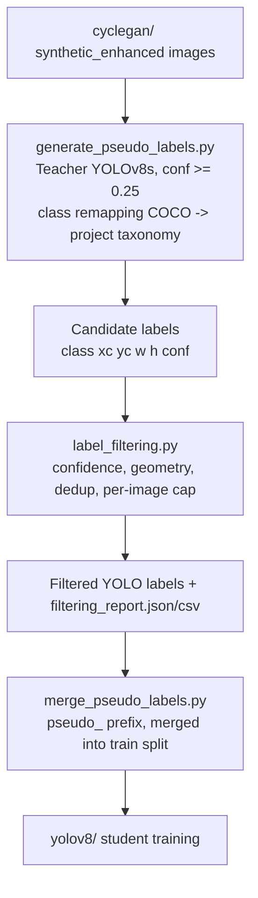

# Pseudo-Labeling Module

This directory implements the semi-supervised label-propagation stage of
the *Breaking reCAPTCHAv2* pipeline. CycleGAN-enhanced synthetic images
(`../cyclegan/generate_synthetic.py`) have no bounding-box annotations; a
pretrained *teacher* detector (COCO-pretrained YOLOv8s) is used to produce
candidate boxes, which are filtered for reliability and merged into the
training split used by `../yolov8/`.

## 1. Motivation

As described in `../dataset_preparation/README.md`, only a 3-class subset
of the images ships with ground-truth boxes, while the full taxonomy has 12
classes. Manual annotation of the remainder is costly, so we use
*self-training with a fixed teacher* (Lee, 2013; Xie et al., 2020): a
detector trained on large external data (COCO) labels unlabeled target-domain
images, and a student detector is then trained on real + pseudo-labeled data.
Applying the teacher to CycleGAN-enhanced images (rather than raw tiles)
aims to improve teacher recall/confidence on low-quality inputs.

## 2. Pipeline



## 3. Method

### 3.1 Candidate generation (`generate_pseudo_labels.py`)

For each enhanced image `x`, the teacher `T` returns boxes
`{(c_k, b_k, s_k)}` with class `c_k`, normalized box `b_k`, and confidence
`s_k`. A permissive threshold (`0.25`, as in the original notebook) is used
so that selection can be swept offline without re-running inference.

### 3.2 Class-space alignment (important)

A COCO teacher emits COCO class ids (0 = person, 1 = bicycle, ...). The
original notebook wrote these ids directly into YOLO label files, which
silently mixes the COCO id space with the project's class ids (e.g. COCO
"person" = 0 would collide with project class 0). This module therefore
remaps COCO names to the project taxonomy and discards unmapped classes:

| COCO class | Project class |
|---|---|
| bicycle | Bicycle |
| car | Car |
| motorcycle | Motorcycle |
| bus | Bus |
| traffic light | Traffic Light |
| fire hydrant | Hydrant |

`--keep_raw_coco_ids` reproduces the original un-remapped behaviour for
comparison. **Note:** Chimney, Crosswalk, and Stair (the only classes with
ground-truth boxes) have no COCO counterpart, so the teacher cannot produce
pseudo-labels for them. Pseudo-labels therefore extend the *other*
taxonomy classes. Training on real + pseudo data requires a `dataset.yaml`
whose `names` covers the union of both class sets (the 3-class
`dataset.yaml` from `../dataset_preparation/` must be extended accordingly,
otherwise pseudo-label class ids will exceed `nc`). This should be stated
explicitly in the paper's methodology.

### 3.3 Filtering (`label_filtering.py`)

Selection function for a candidate box `(c, b, s)`:

```
keep(c, b, s) = [ s >= tau_c ] AND [ a_min <= area(b) <= a_max ]
                AND [ not suppressed by a higher-confidence same-class box with IoU > rho ]
```

| Parameter | Default | Meaning |
|---|---|---|
| `tau` (`--conf_threshold`) | 0.5 | Global confidence threshold |
| `tau_c` (`--per_class_conf`) | none | Optional per-class override |
| `a_min` / `a_max` | 0.0005 / 0.9 | Normalized box-area bounds |
| `rho` (`--dedup_iou`) | 0.8 | Same-class duplicate suppression IoU |
| `--max_boxes` | 20 | Per-image cap (highest confidence kept) |
| `--keep_empty` | off | Keep images with no surviving boxes as background |

The default `tau = 0.5` is a design choice of this module, higher than the
0.25 used for candidate generation; it should be tuned (Section 6).

### 3.4 Merging (`merge_pseudo_labels.py`)

Surviving images/labels are copied into `images/train` / `labels/train`
with a `pseudo_` filename prefix, so real-only vs. real + pseudo ablations
reduce to a filename filter. If validation is empty, `--ensure_val` moves a
fraction of *real* images to validation, guaranteeing that no
pseudo-labeled image is ever used for validation.

## 4. Algorithm

```text
Algorithm 2: Teacher-based pseudo-labeling on CycleGAN-enhanced images
----------------------------------------------------------------------
Input:  Enhanced images U, teacher T, class map M, thresholds (tau, a_min, a_max, rho, K)
Output: Pseudo-labeled set D_p

 1: D_p <- {}
 2: for each image u in U do
 3:     B <- T.predict(u, conf = 0.25)                       # candidates (c, b, s)
 4:     B <- { (M[c], b, s) : (c, b, s) in B, c in dom(M) }   # class remapping
 5:     B <- { (c, b, s) in B : s >= tau_c and a_min <= area(b) <= a_max }
 6:     sort B by s descending; greedily drop same-class boxes with IoU > rho to a kept box
 7:     B <- first K boxes of B
 8:     if B is non-empty (or keep_empty) then D_p <- D_p + {(u, B)}
 9: end for
10: return D_p
```

## 5. Repository Contents

```
pseudo_labeling/
├── README.md
├── generate_pseudo_labels.py   # teacher inference -> candidate labels (with confidence)
├── label_filtering.py          # selection rules + retention report
└── merge_pseudo_labels.py      # merge into the YOLO train split
```

## 6. Usage

```bash
pip install ultralytics

python generate_pseudo_labels.py --images_dir /content/synthetic_enhanced \
    --output_dir /content/pseudo_labels_raw --teacher_weights yolov8s.pt --conf 0.25

python label_filtering.py --raw_labels_dir /content/pseudo_labels_raw \
    --output_dir /content/pseudo_labels_filtered --conf_threshold 0.5

python merge_pseudo_labels.py --images_dir /content/synthetic_enhanced \
    --filtered_labels_dir /content/pseudo_labels_filtered \
    --dataset_dir /content/yolo_dataset --ensure_val
```

Outputs: `generation_stats.json`, filtered label files,
`filtering_report.json` / `filtering_report.csv`.

## 7. Result Tables (templates)

The cells marked `TBD` must be filled from the JSON/CSV reports produced by
your own runs; no values are supplied here because only real experiments
can populate them validly.

**Table A. Pseudo-label statistics** (from `generation_stats.json`, `filtering_report.json`)

| Quantity | Value |
|---|---|
| Enhanced images processed | TBD |
| Images with >= 1 candidate box | TBD |
| Candidate boxes (after class mapping) | TBD |
| Boxes kept after filtering | TBD |
| Box retention rate | TBD |
| Images merged into train | TBD |

**Table B. Boxes per class** (`kept_boxes_per_class`)

| Class | Candidates | Kept |
|---|:---:|:---:|
| Bicycle / Bus / Car / Hydrant / Motorcycle / Traffic Light | TBD | TBD |

**Table C. Confidence-threshold sensitivity** (rerun `label_filtering.py` with each `tau`, train, evaluate with `../evaluation/compute_metrics.py`)

| tau | Boxes kept | Images merged | mAP@0.5 | mAP@0.5:0.95 |
|:---:|:---:|:---:|:---:|:---:|
| 0.25 | TBD | TBD | TBD | TBD |
| 0.50 | TBD | TBD | TBD | TBD |
| 0.70 | TBD | TBD | TBD | TBD |

**Table D. Ablation**

| Training data | mAP@0.5 | mAP@0.5:0.95 |
|---|:---:|:---:|
| Real only | TBD | TBD |
| Real + pseudo (raw images) | TBD | TBD |
| Real + pseudo (CycleGAN-enhanced) | TBD | TBD |

## 8. Limitations

- Pseudo-label quality is bounded by the teacher; systematic teacher errors
  are reinforced in the student (confirmation bias).
- The teacher is not adapted to the reCAPTCHA domain, and cannot label
  classes outside COCO (Chimney, Crosswalk, Stair, Bridge, Palm).
- Teacher confidence is not a calibrated probability of correctness; no
  human audit of pseudo-label precision is included unless you add one
  (recommended: manually check a random sample and report its precision).

## 9. References

- Lee, D.-H. (2013). *Pseudo-Label: The Simple and Efficient Semi-Supervised Learning Method for Deep Neural Networks*. ICML Workshop.
- Xie, Q., Luong, M.-T., Hovy, E., & Le, Q. V. (2020). *Self-Training with Noisy Student Improves ImageNet Classification*. CVPR.
- Jocher, G., Chaurasia, A., & Qiu, J. (2023). *Ultralytics YOLOv8*. https://github.com/ultralytics/ultralytics
